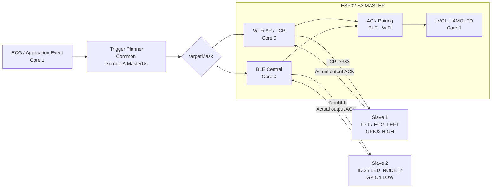

# ECG Wi-Fi + BLE Master

ESP32-S3 tabanlı bu proje, **Wi-Fi ve BLE kullanan farklı ESP32 slave cihazlarını ortak bir master saatine göre deterministik olarak tetiklemek** için geliştirilmiştir.

Mevcut sistem iki aktif slave kullanır:

- **Slave 1 — Wi-Fi:** `DEVICE_ID = 1`, cihaz adı `ECG_LEFT`
- **Slave 2 — BLE:** mantıksal ID `2`, BLE adı `LED_NODE_2`

Master iki transportu aynı anda çalıştırır. Her iki zorunlu slave bağlı ve saat senkronizasyonu tamamlanmış olmadan ECG trigger üretimi başlamaz.

> **LED sistemin amacı değildir.** LED'ler, haberleşme ve gerçek zamanlı zamanlama doğrulamasını görünür hale getiren demo çıkışlarıdır. Temel amaç, farklı transportlardan çalışan fiziksel çıkışları aynı master zamanında çalıştırabilmektir.

---

## Son Donanım Yapısı

### Master

| Özellik | Değer |
|---|---|
| MCU | ESP32-S3 |
| Ekran | Waveshare 1.43" 466×466 AMOLED |
| Framework | Arduino + PlatformIO |
| Grafik | Arduino GFX `1.6.5` |
| UI | LVGL `8.3.11` |
| BLE | NimBLE-Arduino `2.5.0` |
| Board | `esp32-s3-devkitc1-n16r8` |
| PlatformIO environment | `esp32-s3-touch-amoled-1-43` |

### Slave 1 — Wi-Fi

| Özellik | Değer |
|---|---|
| MCU | ESP32 |
| `DEVICE_ID` | `1` |
| Cihaz adı | `ECG_LEFT` |
| Transport | Wi-Fi + TCP |
| LED GPIO | **GPIO2** |
| LED aktif seviye | **Active-high** |
| Default PlatformIO env | `slave-gpio2-active-high` |

Slave 1 master'ın açtığı ağa bağlanır:

```text
SSID:     ECG_MASTER
Password: ecgmaster123
Master:   192.168.4.1
TCP:      3333
```

Slave 1 kaynak kodunda LED varsayılanı GPIO4/active-low olsa da **aktif PlatformIO environment build flag'leri GPIO2/active-high değerlerini override eder**. Donanım davranışını değerlendirirken aktif environment esas alınmalıdır.

### Slave 2 — BLE

| Özellik | Değer |
|---|---|
| MCU | ESP32 |
| Mantıksal ID | `2` |
| BLE adı | `LED_NODE_2` |
| Transport | BLE only |
| LED GPIO | **GPIO4** |
| LED aktif seviye | **Active-low** |
| Board | `esp32dev` |
| PlatformIO environment | `slave2-ble` |

Slave 2 ayrı `slave2_ble` PlatformIO projesidir ve Wi-Fi kullanmaz.

---

## Sistem Mimarisi



### Core dağılımı

| Core | Sorumluluk |
|---|---|
| **Core 0** | Wi-Fi, TCP, BLE, bağlantı yönetimi, sync paketleri, transport TX/RX |
| **Core 1** | LVGL, ECG olayları, trigger planlama, ACK karşılaştırma ve UI |

Wi-Fi ve BLE görevleri FreeRTOS ile Core 0'a pinlenmiştir. LVGL yalnızca UI sahibi Core 1 tarafından kullanılmalıdır.

---

## Projenin Asıl Amacı

Master ve slave cihazların `esp_timer_get_time()` sayaçları aynı başlangıç noktasına sahip değildir. Bu nedenle sistem önce her slave'in master'a göre saat ofsetini ölçer.

Master daha sonra her olay için gelecekteki ortak bir:

```cpp
executeAtMasterUs
```

zamanı belirler.

Slave paketi aldığı anda LED'i çalıştırmaz. Hedef master zamanını kendi yerel zaman alanına çevirir:

```text
executeAtLocalUs = executeAtMasterUs + clockOffsetUs
```

ve fiziksel çıkışı ancak yerel sayaç bu değere ulaştığında çalıştırır.

Bu tasarım sayesinde Wi-Fi ve BLE paketlerinin iletim süreleri farklı olsa bile, yeterli lead time bulunduğu sürece iki slave aynı **master zamanını** hedefler.

Gelecekte LED yerine röle, stimülatör, motor, ses çıkışı, ölçüm başlatma sinyali veya başka bir gerçek zamanlı fiziksel çıkış kullanılabilir. Bu değişiklik senkronizasyon protokolünü bozmamalıdır.

---

## Saat Senkronizasyonu

Offset tanımı:

```text
clockOffsetUs = slaveClock - masterClock
```

Temel sync akışı:

```text
MASTER                                      SLAVE

t1
 | -------- MSG_SYNC_REQ ------------------> |
 |                                           | t2 = receive time
 |                                           | t3 = response time
 | <------- MSG_SYNC_RESP ------------------ |
t4
 |
 | ---- MSG_SYNC_COMMIT(offsetUs) ---------> |
```

Master RTT ve clock offset'i hesaplar. Slave `MSG_SYNC_COMMIT` aldıktan sonra senkron kabul edilir.

Trigger dönüşümü:

```text
slaveExecuteUs = executeAtMasterUs + clockOffsetUs
```

Wi-Fi ACK içindeki `actualLocalUs`, master tarafında:

```text
actualMasterUs = actualLocalUs - clockOffsetUs
```

ile tekrar master zaman alanına çevrilir.

BLE tarafında da `ledOnAtLocalUs - offsetUs` kullanılır.

Böylece iki transporttan gelen gerçek fiziksel çalışma zamanları ortak master zaman ekseninde karşılaştırılır.

---

## Dinamik Lead Time

Master sabit bir "paketi şimdi gönder ve hemen çalıştır" yaklaşımı kullanmaz.

Wi-Fi ve BLE kendi önerilen lead time değerlerini üretir. Ortak trigger için:

```cpp
leadUs = max(wifiRecommendedLeadUs(), bleRecommendedLeadUs());
```

kullanılır.

Böylece iki transport da aynı gelecekteki `executeAtMasterUs` anına yetişebilecek kadar süre kazanır.

Mevcut Wi-Fi kodunda önerilen lead time yaklaşık **200–600 ms** aralığında sınırlandırılır. BLE tarafı da kendi RTT durumuna göre lead time önerir.

---

## Hazır Olma Koşulu

Mevcut iki cihazlı sistemde her iki slave zorunludur.

Master'ın trigger kabul etmesi için:

```text
Wi-Fi Slave 1 synced
AND
BLE Slave 2 synced
```

olmalıdır.

`mixedSystemReady()` doğrudan bu iki durumu kontrol eder.

Bir transport hazır değilse ECG olayı fiziksel trigger'a dönüştürülmez.

---

## Trigger Yönlendirme

Ortak `TriggerPacket` içinde:

```cpp
uint64_t targetMask;
```

bulunur.

Mevcut eşleme:

| Bit | Hedef |
|---:|---|
| Bit 0 | Slave 1 / ID 1 / Wi-Fi |
| Bit 1 | Slave 2 / ID 2 / BLE |

`targetMask == 0`, uygun hedeflere broadcast anlamına gelir.

`maskForDevice()` ID 1..64 değerlerini güvenli biçimde 64-bit maskeye dönüştürür:

```cpp
constexpr uint64_t maskForDevice(uint8_t deviceId) {
    if (deviceId < 1 || deviceId > 64) return 0;
    return 1ULL << (deviceId - 1);
}
```

### Önemli

64-bit mask desteği **master'ın bugün 64 slave yönettiği anlamına gelmez**.

Mevcut karma master uygulaması aktif olarak:

- Wi-Fi ID 1
- BLE ID 2

topolojisine göre yapılandırılmıştır. Yeni cihaz eklemek için cihaz/transport yönetiminin de genişletilmesi gerekir.

---

## BLE UUID'leri

| Amaç | UUID |
|---|---|
| Service | `6e400001-b5a3-f393-e0a9-e50e24dcca9e` |
| RX — Master → Slave | `6e400002-b5a3-f393-e0a9-e50e24dcca9e` |
| TX — Slave → Master | `6e400003-b5a3-f393-e0a9-e50e24dcca9e` |

---

## Mesaj Türleri

| Mesaj | Açıklama |
|---|---|
| `MSG_SYNC_REQ` | Master sync isteği |
| `MSG_SYNC_RESP` | Slave timestamp cevabı |
| `MSG_SYNC_COMMIT` | Hesaplanan offset'in slave'e gönderilmesi |
| `MSG_TRIGGER` | Gelecekte planlanmış fiziksel çıkış komutu |
| `MSG_LED_ON_ACK` | Fiziksel çıkışın gerçekten çalıştığı zaman |
| `MSG_HELLO` | Wi-Fi slave kimliği |
| `MSG_DEVICE_STATUS` | Wi-Fi slave telemetrisi |

---

## Wi-Fi ve BLE Wire Format Farkı

Wi-Fi ve BLE aynı zamanlama semantiğini kullanır ancak mevcut wire packet'leri birebir aynı değildir.

### Ortak sync paketleri

| Struct | Boyut |
|---|---:|
| `SyncRequest` | 13 byte |
| `SyncResponse` | 21 byte |
| `SyncCommit` | 13 byte |

### Wi-Fi

| Struct | Boyut |
|---|---:|
| `TriggerPacket` | 26 byte |
| `LedOnAck` | 17 byte |
| `HelloPacket` | 26 byte |
| `DeviceStatusPacket` | 11 byte |

Wi-Fi `TriggerPacket` içinde `targetMask` bulunur.

Wi-Fi ACK ayrıca:

```cpp
int32_t latenessUs;
int64_t actualLocalUs;
```

alanlarını taşır.

### BLE

| Struct | Boyut |
|---|---:|
| `BleTriggerPacket` / Slave 2 `TriggerPacket` | 18 byte |
| `BleLedOnAck` / Slave 2 `LedOnAck` | 13 byte |

Mevcut BLE Slave 2 wire protokolünde `targetMask` ve `latenessUs` yoktur.

Master bu farkı BLE transport sınırında dönüştürür:

```text
Common TriggerPacket
        |
        v
bleSendTrigger()
        |
        v
BleTriggerPacket
        |
        v
BLE Slave 2
```

Bu uyumluluk katmanı bilinçlidir. BLE slave protokolünü Wi-Fi struct'ına zorla eşitlemek mevcut cihazla geriye uyumluluğu bozabilir.

---

## ACK ve Gerçek Çıkış Zamanı Karşılaştırması

ACK, paketin alındığı zamanı değil fiziksel çıkışın gerçekten aktif edildiği zamanı temsil eder.

Master aynı `eventId` için Wi-Fi ve BLE ACK'lerini eşleştirir.

İki ACK geldiğinde:

```text
differenceUs = BLE_actualMasterUs - WiFi_actualMasterUs
```

hesaplanır.

Seri portta örnek:

```text
[MIXED ACK] #42 BLE-WIFI:+850 us
```

Ekranda da `BLE - WiFi` farkı gösterilir.

Bu değer transport paket gecikmesini değil, master zaman alanına çevrilmiş **gerçek çıkış zamanları arasındaki farkı** temsil eder.

---

## Protokol Sözleşmesi — Değiştirilmemeli

1. Master tek referans saattir.
2. Slave trigger paketini aldığı anda çıkışı çalıştırmaz.
3. Master trigger'ı yeterli lead time ile geleceğe planlar.
4. Slave `executeAtMasterUs + clockOffsetUs` ile kendi hedef yerel zamanını bulur.
5. Çıkış hedef yerel zamana ulaşıldığında çalıştırılır.
6. Wire struct'ları `packed` kalmalıdır.
7. Master ve ilgili slave'in kullandığı wire struct boyutları birebir eşleşmelidir.
8. Wi-Fi ve BLE'nin farklı wire format kullanması, ortak zamanlama semantiğini değiştirmemelidir.
9. Transport gecikmesi hedef zamanı değiştirmemeli; yalnızca lead time gereksinimini etkileyebilmelidir.
10. Senkron olmayan zorunlu cihaza trigger gönderilmemelidir.
11. ACK gerçek fiziksel çıkış zamanını bildirmelidir.
12. LVGL yalnızca Core 1/UI sahibi tarafından çağrılmalıdır.
13. Wi-Fi/BLE görevleri LVGL fonksiyonlarını doğrudan çağırmamalıdır.
14. GPIO ve active-high/active-low ayarları donanım doğrulanmadan değiştirilmemelidir.
15. Slave kimliği bağlantı sırası, IP veya MAC sırasına göre belirlenmemelidir.

---

## Slave Kimliği

Wi-Fi slave bağlandıktan sonra `HelloPacket` gönderir:

```cpp
struct __attribute__((packed)) HelloPacket {
    uint8_t type;
    uint8_t deviceId;
    char deviceName[24];
};
```

Master Wi-Fi bağlantısını mantıksal `DEVICE_ID` ile eşler.

Bu nedenle cihazın hangi sırada bağlandığı IP/TCP slotunun cihaz kimliğini değiştirmez.

Master ayrıca:

- `DEVICE_ID == 0` değerini reddeder.
- Aynı anda kullanılan duplicate `DEVICE_ID` bağlantılarını reddeder.

---

## Yeni Slave Ekleme

Yeni bir `DEVICE_ID` tanımlamak tek başına yeterli değildir.

Yeni cihaz eklenirken:

1. Benzersiz, sıfırdan farklı bir ID verin.
2. ID 1..64 ise `maskForDevice(id)` ile hedef maskesi üretilebilir.
3. Cihazın transport türünü açıkça kaydedin.
4. Uygulama mantığı `id == 1 → Wi-Fi`, `id == 2 → BLE` gibi kalıcı varsayımlara bağlanmamalıdır.
5. İlgili wire protocol struct'larını master ve slave arasında doğrulayın.
6. `SYNC_REQ → SYNC_RESP → SYNC_COMMIT` akışını tamamlayın.
7. Trigger'ı alır almaz çalıştırmak yerine yerel hedef zamanına dönüştürüp kuyruğa alın.
8. Cihazın `required` veya optional olduğunu tanımlayın.
9. ACK, timeout, reconnect, queue reject ve late drop sayaçlarını cihaz bazında yönetin.
10. UI'yi gerekirse dinamik cihaz listesine genişletin.
11. Master ve değiştirilen slave projelerini yeniden derleyin.
12. Gerçek donanımda çıkışları osiloskop veya logic analyzer ile aynı zaman ekseninde doğrulayın.

---

## Gelecekte Önerilen Device Registry

Mevcut kod iki cihazlı demo için `WIFI_NODE_ID` ve `BLE_NODE_ID` sabitlerini kullanır.

Daha fazla slave için önerilen yapı:

```cpp
enum class TransportType : uint8_t {
    WiFi,
    Ble
};

struct DeviceConfig {
    uint8_t id;
    const char *name;
    TransportType transport;
    bool required;
};
```

Runtime durumunda cihaz başına en az:

- connected
- synced
- clock offset
- RTT
- jitter
- transport slot/connection
- son sync zamanı
- son status zamanı
- trigger/ACK bilgisi
- queue reject
- late drop
- timeout

tutulmalıdır.

Hedef mimari:

```text
ECG / Application Event
          |
          v
Common executeAtMasterUs
          |
          v
Resolve targetMask
          |
          v
Device Registry
      /       \
     v         v
 Wi-Fi       BLE
Transport  Transport
     \         /
      v       v
Each slave converts the SAME master timestamp
          |
          v
Synchronized physical outputs
```

Transport katmanı paketi taşır; uygulama mantığı transporttan bağımsız kalır.

---

## UI ve Performans

Mevcut kodda:

```cpp
UI_FRAME_INTERVAL_MS  = 16
UI_STATUS_INTERVAL_MS = 500
```

UI durum bilgileri yaklaşık **500 ms** aralıkla yayımlanır.

Değişmeyen LVGL etiketleri tekrar çizilmemeye çalışılır. RTT metni küçük değişimlerde sürekli redraw oluşturmaması için bucket'lanır.

Wi-Fi ve BLE ağ işlemlerinin Core 0'da tutulmasının, LVGL'nin ise Core 1'de kalmasının amacı ekran takılmalarının ve zamanlama jitter'ının azaltılmasıdır.

---

## Repo Yapısı

```text
.
├── platformio.ini                  # ESP32-S3 master
├── include/
│   ├── config.h
│   ├── protocol.h
│   ├── ui.h
│   └── lv_conf.h
├── src/
│   ├── main.cpp
│   ├── wifi_master.cpp
│   ├── wifi_master.h
│   ├── ble_master.cpp
│   ├── ble_master.h
│   ├── event_scheduler.cpp
│   ├── event_scheduler.h
│   ├── fake_ecg.cpp
│   ├── fake_ecg.h
│   └── ui.cpp
├── slave1_wifi/
│   ├── platformio.ini
│   ├── include/
│   └── src/
├── slave2_ble/
│   ├── platformio.ini
│   ├── include/
│   └── src/
├── PROTOCOL.md
├── CODE_REVIEW.md
└── .gitignore
```

Eski `ecgslave2_wifi` / Wi-Fi `ECG_RIGHT` projesi mevcut aktif topolojinin parçası değildir ve GitHub-ready pakete dahil edilmemiştir.

---

## Derleme

### Master

Repo kökünde:

```powershell
pio run
```

veya:

```powershell
platformio run
```

### Wi-Fi Slave 1

Default environment zaten GPIO2 active-high'dır:

```powershell
platformio run -d slave1_wifi
```

İstenirse environment açıkça belirtilebilir:

```powershell
platformio run -d slave1_wifi -e slave-gpio2-active-high
```

### BLE Slave 2

```powershell
platformio run -d slave2_ble
```

---

## Donanıma Yükleme

COM portlarını sabit kabul etmeyin.

Önce:

```powershell
platformio device list
```

Master:

```powershell
platformio run -t upload --upload-port COMx
```

Wi-Fi Slave 1:

```powershell
platformio run -d slave1_wifi -e slave-gpio2-active-high -t upload --upload-port COMx
```

BLE Slave 2:

```powershell
platformio run -d slave2_ble -t upload --upload-port COMx
```

`COMx`, o anda işletim sisteminin cihaza verdiği gerçek port ile değiştirilmelidir.

---

## Önemli Bağımlılıklar

### Master

- Arduino GFX Library `1.6.5`
- LVGL `8.3.11`
- NimBLE-Arduino `2.5.0`
- ESP32 Arduino WiFi

### BLE Slave 2

- NimBLE-Arduino `2.5.0`

---

## Başka Bir Codex / GPT İçin Geliştirme Talimatı

Bu repoda değişiklik yapmadan önce yapay zeka birlikte şunları incelemelidir:

- master `include/protocol.h`
- Wi-Fi slave `include/protocol.h`
- BLE slave `include/protocol.h`
- `wifi_master.cpp`
- `ble_master.cpp`
- `event_scheduler.cpp`
- ilgili slave `main.cpp`
- PlatformIO environment/build flag'leri

Değişiklikten sonra şu soruların tamamı kontrol edilmelidir:

- Mevcut Wi-Fi ID 1 + BLE ID 2 davranışı geriye uyumlu mu?
- Wi-Fi ve BLE aynı `executeAtMasterUs` değerini mi hedefliyor?
- Her slave master zamanını kendi local clock'una dönüştürüyor mu?
- Clock offset işareti `slaveClock - masterClock` olarak korunuyor mu?
- İlgili packed struct boyutları iki uçta eşleşiyor mu?
- BLE compatibility packet'leri yanlışlıkla Wi-Fi formatıyla değiştirilmiş mi?
- Trigger yeterli lead time ile geleceğe planlanıyor mu?
- Senkron olmayan required cihaz trigger'ı engelliyor mu?
- ACK gerçek fiziksel çıkış zamanını mı bildiriyor?
- Bir transporttaki bloklama diğer transportu veya UI'yi etkiliyor mu?
- LVGL yalnızca Core 1'den mi çağrılıyor?
- Yeni cihaz eklenirken bağlantı sırası/IP/MAC kimlik olarak kullanılmıyor mu?
- ID 1..64 mask hesabı güvenli mi?
- GPIO/active-level build flag'leri korunuyor mu?
- Master ve değiştirilen tüm slave projeleri PlatformIO ile hatasız derleniyor mu?

> **Öncelik ekrandaki animasyon veya LED metni değildir. Öncelik, hedef cihazların transporttan bağımsız olarak aynı master zamanında deterministik şekilde fiziksel çıkış üretmesidir.**
